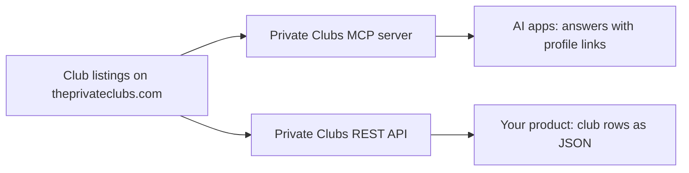

Private Clubs serves the club listings on theprivateclubs.com in two ways. AI apps reach them through the Private Clubs MCP server, and your own product reaches them through the Private Clubs REST API. Both read the same listed clubs, and MCP answers link people back to each club's profile.

## Choose MCP or the API

MCP (Model Context Protocol) connects Private Clubs to compatible AI apps and agents, such as Claude, ChatGPT and Cursor. The server offers five tools: `search_clubs`, `get_club`, `get_clubs_by_state`, `compare_clubs` and `get_membership_info`. Your AI app picks the tool that fits the question. Start with the [MCP quickstart](/mcp/getting-started).

The REST API lets you integrate Private Clubs into an application, backend or automated workflow. It has one endpoint, `GET /api/v1/clubs`, which returns up to 50 clubs a page and the first 500 results of a search. Call it from your server, because it sends no CORS headers. Bulk access is a paid data feed license. See [Bulk data](/api/usage-limits#bulk-data). Start with the [API quickstart](/api).

Both read the same directory, so choose the one that fits where you work.

## What comes back

Only listed public clubs appear. Drafts, closed or hidden listings and merged duplicates never do.

Each club comes with profile basics: name, city, state, country and type. Course data covers holes, par, yardage and course architect, and is often empty for clubs without a course. You also get amenities and waitlist status where the listing has them.

MCP results carry a `url` that opens the club's profile on theprivateclubs.com. API rows do not include a profile link.

## How fees work

Private Clubs never returns membership fees over MCP, and API calls from your server or script return none. Account holders see fees on each club's profile at theprivateclubs.com.

API responses carry a `fee_access` field. For calls without a theprivateclubs.com session, which is every call from your server or script, it is `locked` and the fee fields come back as `null`. See [Authentication and fees](/api/authentication).

## Keep a listing current

A club can claim its listing for free at [theprivateclubs.com/list](https://www.theprivateclubs.com/list). It takes a work email and no credit card. See [Check your club's listing](/guides/clubs).

Next, [connect an AI app](/mcp/getting-started) or [make your first API request](/api).
